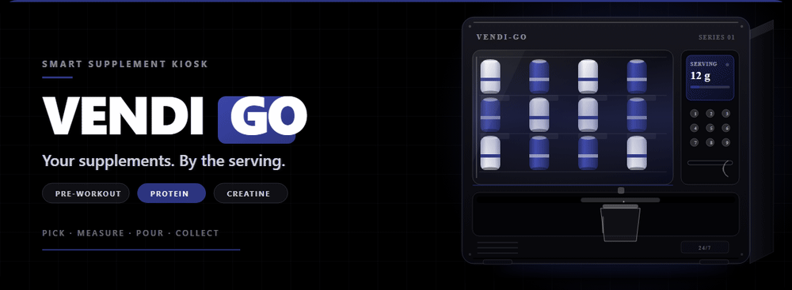
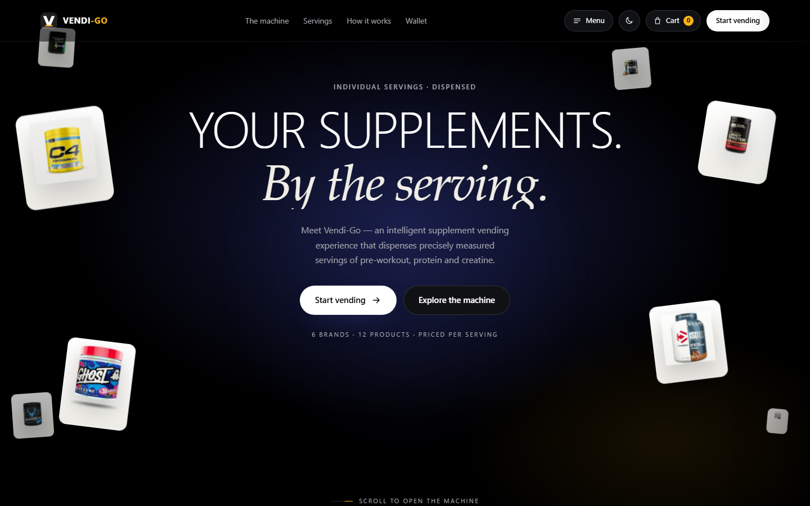

<div align="center">
  
  <br />
  <a href="assets/readme/vendi-go-hero.svg"><sub>animated SVG version</sub></a>
</div>

<p align="center">
  <a href="https://vendi-go.antideploy.app/"></a>
  <a href="#the-catalogue"></a>
  <a href="#run-it"></a>
  <a href="#tech"></a>
</p>

<h1 align="center">Vendi-Go</h1>
<p align="center"><strong>Your supplements. By the serving.</strong></p>
<p align="center">A concept storefront for a smart supplement kiosk — <a href="https://vendi-go.antideploy.app/">vendi-go.antideploy.app</a></p>

---

## What this is

Vendi-Go is a concept for an intelligent supplement vending machine. You choose a
product, pick a number of label servings, pay — and the kiosk dispenses a
precisely measured dose into a fresh cup. Pre-workout, protein or creatine, priced
**per serving instead of per tub**, so you can try a brand without committing to
400 g of it.

This repository is the storefront for that idea: the machine story, the
catalogue, the serving flow, the wallet and the ordering drawer, in one page. It
is a front-end concept — no dispensing hardware is connected, no payment is
taken, and the stock, prices and wallet balances are demo data.

## The machine

The machine is the product. Three stages make it different from a snack vendor:

| Stage | What happens |
| --- | --- |
| **01 — Sealed** | Three food-grade chambers hold the powders. No open scoops, no shared tubs. |
| **02 — Weighed** | An auger doses; a load cell checks. Each product has its own calibration, and the serving is weighed before it leaves the nozzle. |
| **03 — Poured** | One measured serving, into the cup. Nothing dispenses until payment clears, and the tray unlocks only when the weight matches the label serving. |

In the demo the kiosk is **Machine 04 · Connaught Place**, built as `SERIES 01`
with sealed hoppers and load-cell verification.

## What is on the site

- **The machine** — the three stages above as an animated walkthrough, with a
  live serving counter and a `SELECT · PAY · COLLECT` sequence.
- **Servings** — 12 products from 6 brands, filterable by category: 5
  pre-workout, 5 protein, 2 creatine.
- **Label data** — every product opens with its serving weight, active content
  (for example caffeine per serving) and remaining servings.
- **How it works** — choose, pay, collect, with grams and per-serving price shown
  before you confirm.
- **Wallet** — a demo balance, top-ups and a serving history, so a dose is a line
  item and not a guess.
- **Find a machine** — concept locations in Delhi NCR, Mumbai and Bengaluru.
- **Cart drawer** — servings, quantity, total, and a demo "Pay & dispense" step.
- **Menu** — About, The Machine, How It Works, Product Categories, Serving
  Technology, Hygiene & Safety, Contact.
- **Theme** — dark by default, light on demand, applied before first paint and
  remembered in `localStorage`.

## The catalogue

Twelve products, twelve prices per serving — never per tub. A sample of the shelf:

| Brand | Product | Serving | Per serving | On the label |
| --- | --- | --- | --- | --- |
| Cellucor | C4 Original | 6.5 g | ₹80 | 150 mg caffeine |
| GHOST | Legend Pre-Workout | 12 g | ₹120 | 250 mg caffeine |
| Bucked Up | Bucked Up Pre-Workout | 10.7 g | ₹140 | creatine monohydrate |
| REDCON1 | Total War Pre-Workout | 16.2 g | ₹150 | 325 mg caffeine |
| JYM | Pre JYM | 26 g | ₹170 | 300 mg caffeine |

Also on the shelf: Optimum Nutrition Gold Standard 100% Whey, Dymatize ISO100
Hydrolyzed, MuscleBlaze Biozyme Performance Whey, and creatine from Optimum
Nutrition and MT. The wallet history shows Gold Standard Whey at ₹100 per
serving. Serving weights follow each product's label; stock counts are demo data.

<div align="center">
  
  <br />
  <sub>vendi-go.antideploy.app — the hero, with the shelf cards in motion.</sub>
</div>

## How it works

1. **Choose your supplement.** Pick a product and a flavour, then set the number
   of label servings. Grams and per-serving price appear before payment.
2. **Pay for your serving.** Demo wallet, UPI or card. You are charged per scoop;
   one label serving is the smallest unit.
3. **Collect your measured scoop.** The auger drops the dose into a fresh cup, the
   load cell verifies it, the tray unlocks. Shake and drink.

## Tech

| Layer | Choice |
| --- | --- |
| Markup | `index.html` — one page, no template engine |
| Styles | `styles.css` + `styles-v2…v5.css`, layered by section |
| Behaviour | `app.js` — catalogue, cart, wallet, theme, scroll and pour animation |
| Motion | `assets/lib/gsap.min.js`, `ScrollTrigger.min.js`, `lenis.min.js` |
| Assets | `assets/products/*`, `assets/favicon.svg`, `assets/readme/*` |
| Server | `server.mjs` — Node static server, 127.0.0.1 only |

No framework, no bundler, no build step. The theme is applied by a small inline
script before first paint, motion degrades without JavaScript, and
`prefers-reduced-motion` is honoured by the stylesheets.

## Run it

```bash
node server.mjs
# Vendi-Go running at http://127.0.0.1:5173
```

`PORT` overrides the port. The server resolves every request inside the project
root, refuses path traversal, and falls back to `index.html`.

## Project layout

```
index.html          the page
app.js              behaviour, catalogue state and animation
styles.css          base layer
styles-v2..v5.css   section layers, loaded in order
assets/
  products/         product artwork
  lib/              GSAP, ScrollTrigger, Lenis
  readme/           hero GIF, hero SVG and the site screenshot
  favicon.svg
server.mjs          local static server
```

## Visual assets

The README hero ships twice: `vendi-go-hero.gif` is what GitHub renders as
motion (1000 × 367, 72 frames at 12 fps, one 6-second loop, ~1.7 MB, rasterised
from the SVG at 1200 × 440), and `vendi-go-hero.svg` is the editable SMIL source
illustration of the kiosk.

## Status and limits

- **Concept, not a product.** No dispensing hardware, no backend and no payment
  integration. "Pay & dispense" is a demo step and charges nothing.
- **Demo data.** Stock counts, serving prices, wallet balance, history and machine
  locations are illustrative and reset on reload; only the theme persists.
- **Brands are referenced, not affiliated.** Product photographs and names are
  used for identification only and remain the property of their owners.
- **No test suite or build pipeline.** The site is static files served as-is.

## Deployment

The demo is published at <https://vendi-go.antideploy.app/> as static files.
Deployment output is not part of this repository — the site is the repository.

---

<p align="center"><sub>Built for the shelf, not the tub.</sub></p>
