<div align="center">
  
</div>

<p align="center">
  <a href="#run-it"></a>
  <a href="assets/lib"></a>
  <a href="#run-it"></a>
  <a href="assets/products"></a>
</p>

<h1 align="center">Vendi-Go</h1>
<p align="center"><strong>Your supplements. By the serving.</strong></p>
<p align="center">Pick a product, choose your servings, collect a cup.</p>

---

## What it is

Vendi-Go is the storefront for a smart supplement kiosk. Instead of buying a
whole tub to find out you do not like it, you buy one measured serving:
pre-workout, protein or creatine, dispensed fresh into a cup.

This repository is the site itself — a hand-built, dependency-free front end
with a small local static server. No framework, no bundler, no build step.

## What is in it

- **The machine** — a full-bleed product story with a live serving counter.
- **Shelves** — 12 products with artwork and per-serving pricing.
- **How it works** — pick, measure, pour, collect, as an animated sequence.
- **Wallet** — the serving balance and refill state, held client-side.
- **Theme switch** — dark by default, light on demand, remembered in
  `localStorage` and applied before first paint.
- **Motion** — GSAP + ScrollTrigger for section reveals, Lenis for smooth
  scrolling, and a curtain intro. All of it degrades without JavaScript.
- **Accessible basics** — semantic landmarks, labelled controls, visible focus
  states, and `prefers-reduced-motion` honoured by the stylesheets.

## Stack

| Layer | Choice |
| --- | --- |
| Markup | `index.html` — one page, no template engine |
| Styles | `styles.css` + `styles-v2…v5.css`, layered by section |
| Behaviour | `app.js` — state, cart, theme, scroll and pour animation |
| Motion | `assets/lib/gsap.min.js`, `ScrollTrigger.min.js`, `lenis.min.js` |
| Assets | `assets/products/*`, `assets/favicon.svg` |
| Server | `server.mjs` — Node static server, 127.0.0.1 only |

## Run it

```bash
node server.mjs
# Vendi-Go running at http://127.0.0.1:5173
```

`PORT` overrides the port. The server resolves every request inside the project
root, refuses path traversal, and falls back to `index.html`.

## Project layout

```
index.html          the page
app.js              behaviour and animation
styles.css          base layer
styles-v2..v5.css   section layers, loaded in order
assets/
  products/         product artwork
  lib/              GSAP, ScrollTrigger, Lenis
  favicon.svg
  readme/           this README's animated hero
server.mjs          local static server
```

## Palette

| Token | Value | Use |
| --- | --- | --- |
| Black | `#000000` | page, hero, primary surface |
| White | `#FFFFFF` | type, product cards, controls |
| Cobalt Blue Deep | `#2C3480` | accent, active states, the pour |

The hero above is a single SVG (`assets/readme/vendi-go-hero.svg`) animated
with SMIL, so it needs no GIF and stays under 8 KB. It renders as a still frame
where animation is not supported.

---

<p align="center"><sub>Built for the shelf, not the tub.</sub></p>
